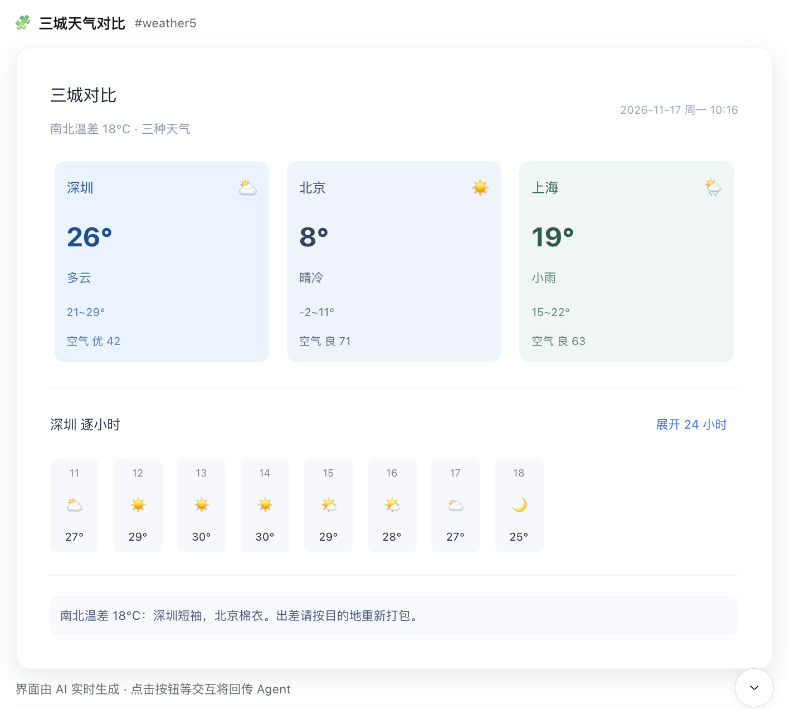

# dsh-a2ui — Real-Time Generative UI for DeepSeek Harness

[中文文档](README_cn.md)

Render AI-generated interactive interfaces directly in conversations on both **DSH Web and Desktop**. The model emits an [A2UI v0.9](https://a2ui.org/) message stream (a superset of the [KuiklyUI-A2UI](https://github.com/Tencent-TDS/KuiklyUI-A2UI) catalog), which this plugin incrementally renders as native Web components—not iframes or Markdown—and sends user interactions back to the Agent.

Kuikly apps on Android, iOS, and HarmonyOS can consume the **same protocol and catalog**: one model response renders as native Views in an app and as Web components in DSH.

## See It in Action



A complete interactive dashboard generated through `render_ui`: live data, reusable components, responsive layouts, and buttons that send actions back to the Agent.

## Features

| Capability | Implementation |
|---|---|
| Real-time / incremental rendering | Multiple `render_ui` calls with the same `surfaceId` update the primary card in place (`createSurface` → `updateComponents` → `updateDataModel` as a stream) |
| 18 standard components | Text / Image / Icon / Button / Card / Column / Row / List / Tabs / Modal / Divider / TextField / CheckBox / ChoicePicker / Slider / DateTimeInput / Video / AudioPlayer |
| Data binding | `{"path": "/xxx"}` JSON Pointer bindings, separate structure and data, and template lists via `children: {path, componentId}` |
| 14 built-in functions | formatString / formatNumber / formatCurrency / formatDate / pluralize / required / regex / email / length / numeric / and / or / not / openUrl (signatures aligned with Kuikly) |
| `styles` visual extensions | Kuikly style properties → CSS (gradients, shadows, transforms, border radius, text styles, and Kuikly shorthand compatibility) |
| Form write-back | Input components write directly to the data model; action context bindings are resolved automatically on submission |
| Action dispatch | Button click → `sendBeacon` preferred (fetch with a 4-second timeout as fallback) → bounded host queue → Agent pulls via `read_ui_actions`; clipboard fallback when unavailable |
| Self-contained protocol guide | The model calls `get_a2ui_guide` to obtain the complete protocol guide and Kuikly catalog JSON |

## Installation

Prerequisite: run DSH once (`npx @deepseek-ai/dsh web` or launch Desktop for the first time) to initialize the profile directory.

**Install directly from GitHub:**

```bash
# Web
dsh plugin --profile web add github:redwood9/dsh-a2ui

# Desktop
dsh plugin --profile desktop add github:redwood9/dsh-a2ui
```

Restart `dsh web` or quit and relaunch Desktop after installation.

**Install from a local checkout:**

```bash
git clone https://github.com/redwood9/dsh-a2ui.git

# Web
dsh plugin --profile web add ./dsh-a2ui
npx @deepseek-ai/dsh web

# Desktop
dsh plugin --profile desktop add ./dsh-a2ui
# Quit and relaunch Desktop
```

You can also install this directory through **Settings → Plugins** in Desktop.

Web and Desktop profiles are isolated, so install the plugin separately for each one. Both use the same client bundle; Desktop runs the same Web UI inside Electron.

**Local development (inside a DSH source checkout):**

```bash
pnpm dsh web --patch ./dsh-a2ui/cordis.dev.yml
```

## Usage

Ask the Agent:

> Use render_ui to create a weather card for Shenzhen showing 26°C, with a "Refresh" button.

The Agent first calls `get_a2ui_guide` to read the protocol guide, then calls `render_ui` to send the message stream. The live card appears in the conversation. When the button is clicked, the Agent receives the `refresh` event through `read_ui_actions` and can continue updating the UI.

Optional prompt for your workspace conventions:

> Prefer render_ui over plain text for status displays, forms, products/cards, and option selection.

## Architecture

```text
Model ──render_ui(surfaceId, messages[])──▶ Host side (index.js)
                                             │  Validate envelopes (src/shared/protocol.js)
                                             ▼
                                   Session log (tool/call + tool/result)
                                             │
Client side (client.js) ◀────────────────────┘
  ├─ tool.call.toolview[key=render_ui] → Live rendering during an open turn
  └─ conversation.chat.turnTail → Persistent cards for completed turns (src/client/view.js)
       ├─ Apply messages to a module-level SurfaceStore (shared by surfaceId)
       ├─ Primary card → renderSurface → 18-component React renderer (src/client/renderer.js)
       │    └─ resolveValue bindings + mapStyles (src/shared/styles.js)
       └─ action → sendBeacon / POST /dsh-a2ui/api/action → host queue
Model ──read_ui_actions─────────────────────▶ Pull the queue and continue with UI updates
```

**Real-time model:** the first call card for a surface is the primary card. It renders the live state and subscribes to the store; subsequent incremental call cards display only a summary. After a session refresh, cards replay messages in log order to rebuild their state automatically.

When a turn completes, `turnTail` replays that turn's messages and displays a persistent card, preventing the UI from disappearing when the standard tool activity area is collapsed.

### Directory Layout

```text
dsh_plugin/
├── package.json              # dsh.bundle + dsh.client manifests
├── cordis.patch.yml          # Plugin mount (package-name resolution)
├── cordis.dev.yml            # Local development mount (absolute path)
├── index.js                  # Host: 3 tools + /dsh-a2ui/api/* HTTP endpoints
├── client.js                 # Generated browser bundle (committed; do not edit directly)
├── src/
│   ├── shared/protocol.js    # A2UI v0.9 state machine / Pointer / bindings / 14 functions
│   ├── shared/styles.js      # Kuikly styles → CSS
│   ├── host/tools.js         # Tool definition factories (dependency-free and unit-testable)
│   └── client/{renderer,view,main}.js
├── catalog/
│   ├── guide.md              # Model protocol guide (returned by get_a2ui_guide)
│   └── kuikly_a2ui_catalog.json
├── scripts/build-client.mjs  # Zero-dependency bundle build
└── test/                     # 23 tests (protocol / real host modules / simulated client)
```

## Development and Testing

```bash
node scripts/build-client.mjs   # Regenerate client.js after changing src/client or src/shared
npm test                        # 9 protocol + 6 host + 8 simulated-client tests
```

`verify-host` creates stubs for official packages under `node_modules/@deepseek-ai/*` for testing only; they are not included in the published package. `simulate-client` loads the real bundle with mini React and exercises the full rendering pipeline.

## Limitations and Notes

- **Protocol version:** implements A2UI **v0.9**, aligned with KuiklyUI-A2UI—not v1.0 with the newer `@path` / `@call` format.
- **Custom components, custom functions, and custom icon registries** (Kuikly extension points) are not exposed yet; only the standard catalog and styles are supported.
- Actions use a **pull model** (the model calls `read_ui_actions`), not push delivery. This fits a "user action → next Agent turn" workflow.
- Input components write to the data model and trigger a full-tree rerender; focus optimization for very large forms remains future work.
- DSH is in Developer Preview. Changes to host APIs such as the `tool.call.toolview` slot or `webServer.register` may require corresponding updates (this implementation has been checked against real community-plugin contracts in DSH 0.1.x).

## License

MIT
