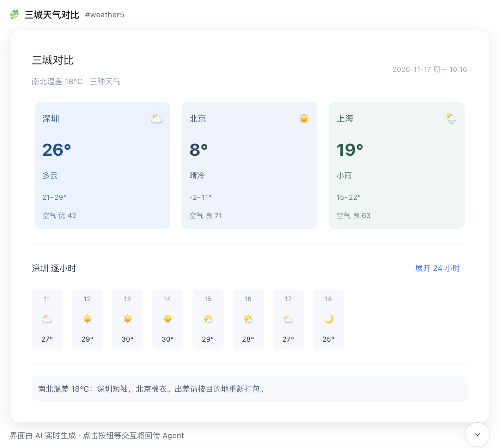

# dsh-a2ui —— DeepSeek Harness 实时生成 UI 插件

[English](README.md)

让 DSH 的 **Web 端与桌面端**在对话中实时渲染 AI 生成的可交互界面：
模型输出 [A2UI v0.9](https://a2ui.org/) 协议流（[KuiklyUI-A2UI](https://github.com/Tencent-TDS/KuiklyUI-A2UI) catalog 超集），
本插件在会话内增量渲染原生 Web 组件（非 iframe / 非 Markdown），并把用户交互回传给 Agent。

与 Kuikly 三端 App（Android / iOS / HarmonyOS）消费**同一份协议与 Catalog**：
同一段模型输出，在 App 里渲染为原生 View，在 DSH 里渲染为 Web 组件。

## 实际效果



一张完整可交互的 AI 生成界面：实时数据、可复用组件、响应式布局，按钮操作可直接回传 Agent。

## 能力总览

| 能力 | 实现 |
|---|---|
| 实时 / 增量渲染 | 同一 `surfaceId` 多次 `render_ui` 调用，主卡片原地更新（createSurface → updateComponents → updateDataModel 流式到达） |
| 18 个标准组件 | Text / Image / Icon / Button / Card / Column / Row / List / Tabs / Modal / Divider / TextField / CheckBox / ChoicePicker / Slider / DateTimeInput / Video / AudioPlayer |
| 数据绑定 | `{"path": "/xxx"}` JSON Pointer 绑定、结构与数据分离、模板列表 `children: {path, componentId}` |
| 14 个内置函数 | formatString / formatNumber / formatCurrency / formatDate / pluralize / required / regex / email / length / numeric / and / or / not / openUrl（签名对齐 Kuikly 实现） |
| `styles` 视觉扩展 | Kuikly styles 属性包 → CSS（渐变 / 阴影 / 变换 / 圆角 / 文本样式等，含 Kuikly shorthand 兼容） |
| 表单写回 | 输入组件直接写回 dataModel，提交时 action context 自动求值 |
| Action 回传 | 按钮点击 → 优先 `sendBeacon`（fetch 4 秒超时兜底）→ host 有界队列 → 模型 `read_ui_actions` 拉取；不可用时降级为剪贴板 |
| 协议指南自举 | 模型先调 `get_a2ui_guide` 获取完整协议手册 + Kuikly catalog JSON |

## 安装

前置：已运行过一次 DSH（`npx @deepseek-ai/dsh web` 或桌面端首次启动），profile 目录已初始化。

**直接从 GitHub 安装：**

```bash
# Web 端
dsh plugin --profile web add github:redwood9/dsh-a2ui

# 桌面端
dsh plugin --profile desktop add github:redwood9/dsh-a2ui
```

安装后重启 `dsh web`，或完全退出并重新打开桌面端。

**从本地 checkout 安装：**

```bash
git clone https://github.com/redwood9/dsh-a2ui.git

# Web 端
dsh plugin --profile web add ./dsh-a2ui
npx @deepseek-ai/dsh web

# 桌面端
dsh plugin --profile desktop add ./dsh-a2ui
# 完全退出并重启桌面端
```

也可以在桌面端 **Settings → Plugins** 中安装本目录。
两端 profile 隔离，需分别安装；客户端 bundle 两端通用（桌面端为 Electron 壳内同一套 Web UI）。

**本地开发（DSH 源码 checkout 内）：**

```bash
pnpm dsh web --patch ./dsh-a2ui/cordis.dev.yml
```

## 使用

对 Agent 说：

> 用 render_ui 给我生成一张天气卡片，城市深圳，温度 26 度，带一个"刷新"按钮。

Agent 会先调用 `get_a2ui_guide` 读取协议手册，然后调用 `render_ui` 下发消息流，
对话中即出现实时卡片；点击按钮后，Agent 通过 `read_ui_actions` 收到 `refresh` 事件并继续更新界面。

引导提示（可选，放进你的工作区约定里效果更佳）：

> 涉及状态展示、表单填写、商品 / 卡片、选项选择时，优先使用 render_ui 生成界面，而不是纯文本。

## 架构

```text
模型 ──render_ui(surfaceId, messages[])──▶ host 半边（index.js）
                                             │  校验 envelope（src/shared/protocol.js）
                                             ▼
                                   会话日志（tool/call + tool/result）
                                             │
client 半边（client.js）◀────────────────────┘
  ├─ tool.call.toolview[key=render_ui] → 进行中轮次实时渲染
  └─ conversation.chat.turnTail → 已完成轮次常驻卡片（src/client/view.js）
       ├─ 应用 messages 到模块级 SurfaceStore（同 surfaceId 共享）
       ├─ 主卡渲染 renderSurface → 18 组件 React 渲染器（src/client/renderer.js）
       │    └─ resolveValue 绑定求值 + mapStyles（src/shared/styles.js）
       └─ action → sendBeacon / POST /dsh-a2ui/api/action → host 队列
模型 ──read_ui_actions──────────────────────▶ 拉取队列，继续新一轮 UI 更新
```

**实时模型**：同一 surface 的第一张调用卡为「主卡」，渲染实时状态并订阅 store；
后续增量调用卡仅显示摘要。会话刷新后各卡按日志顺序重放消息，状态自动重建。
轮次完成后由 `turnTail` 重放本轮消息并显示常驻卡，避免标准模式折叠工具过程区时卡片消失。

### 目录

```text
dsh_plugin/
├── package.json              # dsh.bundle + dsh.client 声明
├── cordis.patch.yml          # 插件挂载（包名方式）
├── cordis.dev.yml            # 本地开发挂载（绝对路径方式）
├── index.js                  # host：3 个工具 + /dsh-a2ui/api/* HTTP
├── client.js                 # 生成的浏览器 bundle（随包提交，勿手改）
├── src/
│   ├── shared/protocol.js    # A2UI v0.9 状态机 / Pointer / 绑定求值 / 14 函数
│   ├── shared/styles.js      # Kuikly styles → CSS
│   ├── host/tools.js         # 工具定义工厂（无依赖，可单测）
│   └── client/{renderer,view,main}.js
├── catalog/
│   ├── guide.md              # 模型协议手册（get_a2ui_guide 返回）
│   └── kuikly_a2ui_catalog.json
├── scripts/build-client.mjs  # 零依赖 bundle 构建
└── test/                     # 23 项测试（协议 / host 真模块 / client 模拟）
```

## 开发与测试

```bash
node scripts/build-client.mjs   # 修改 src/client 或 src/shared 后重新生成 client.js
npm test                        # 协议 9 项 + host 6 项 + client 模拟 8 项
```

测试说明：`verify-host` 会在 `node_modules/@deepseek-ai/*` 下生成官方包 stub
（仅测试用，不进入发布产物）；`simulate-client` 用 mini React 加载真实 bundle 跑全链路。

## 限制与说明

- **协议版本**：实现 A2UI **v0.9**（与 KuiklyUI-A2UI 对齐），非 v1.0（`@path`/`@call` 新格式）。
- **自定义组件 / 自定义函数 / 自定义 Icon 注册表**（Kuikly 扩展通道）尚未开放，仅支持标准 catalog + styles。
- Action 回传为**拉模式**（模型调 `read_ui_actions`），非推送；适合"用户操作 → Agent 下一轮处理"的交互。
- 输入组件写回 dataModel 触发整树重渲，超大表单输入焦点优化留待后续。
- DSH 处于开发者预览期，`tool.call.toolview` slot、`webServer.register` 等宿主 API 如变更需同步适配（本实现已对照 0.1.x 真实社区插件契约）。

## License

MIT
